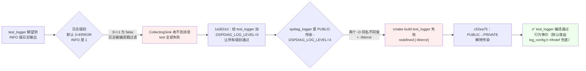
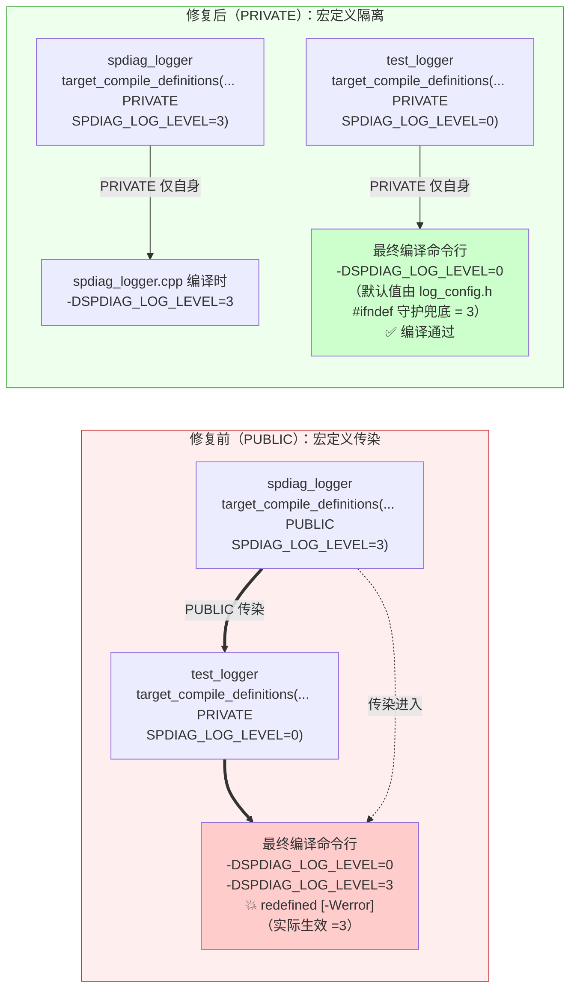
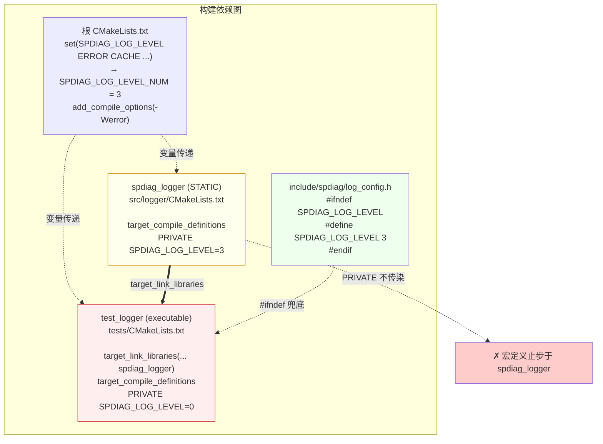
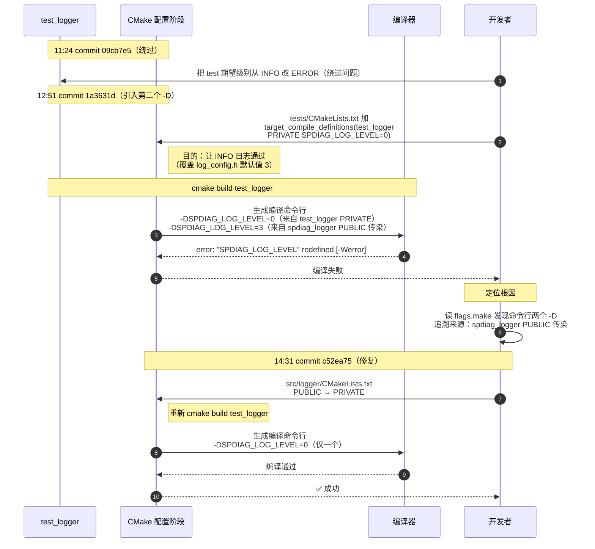
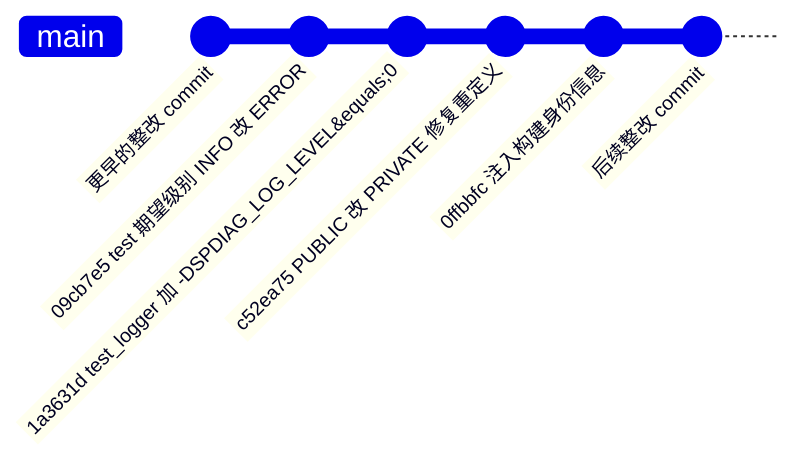

# SPDIAG_LOG_LEVEL 重定义冲突修复记录

> 本文记录 `src/logger/CMakeLists.txt` 中 `target_compile_definitions(spdiag_logger PUBLIC ...)` 改为 `PRIVATE` 的修复过程。改动仅 1 行（外加 4 行注释），但触发该改动的问题链涉及 CMake 可见性关键字、GCC 重定义行为、构建系统配置入口等多个层面，故单独立档。

---

## 1. 问题与原因

### 1.1 现象

`cmake --build build --target test_logger` 编译失败，报错：

```
<command-line>: error: "SPDIAG_LOG_LEVEL" redefined [-Werror]
<command-line>: note: this is the location of the previous definition
cc1plus: all warnings being treated as errors
```

### 1.2 原因定位

报错指出 `SPDIAG_LOG_LEVEL` 在编译命令行被定义两次。从 `build/tests/CMakeFiles/test_logger.dir/flags.make` 取出 test_logger 实际编译定义：

```makefile
CXX_DEFINES = -DSPDIAG_LOG_LEVEL=0 -DSPDIAG_LOG_LEVEL=3 -DSPDIAG_LOG_TO_CONSOLE=1
```

两个 `-DSPDIAG_LOG_LEVEL` 的来源：

| 值 | 位置 | 可见性 |
|---|---|---|
| `=3` | `src/logger/CMakeLists.txt` 第 21 行 `target_compile_definitions(spdiag_logger PUBLIC SPDIAG_LOG_LEVEL=${SPDIAG_LOG_LEVEL_NUM})` | PUBLIC（通过链接关系传染给下游 target） |
| `=0` | `tests/CMakeLists.txt` 第 65 行 `target_compile_definitions(test_logger PRIVATE SPDIAG_LOG_LEVEL=0)` | PRIVATE（仅 test_logger 自身） |

test_logger 通过 `target_link_libraries(test_logger PRIVATE spdiag_logger)` 链接 spdiag_logger。由于 spdiag_logger 的声明是 PUBLIC，`SPDIAG_LOG_LEVEL=3` 经链接关系传染到 test_logger 的编译命令行；test_logger 自身又声明了 `SPDIAG_LOG_LEVEL=0`。两条 `-D` 同时进入编译命令行，触发重定义。

为确认值 `3` 确实来自 PUBLIC 传染而非其它机制（如全局 `add_compile_options`、缓存变量等），在已 configure 的工作树上做单变量对照：仅将 `src/logger/CMakeLists.txt` 第 21 行的 `PUBLIC` 改为 `PRIVATE`，增量 cmake configure 后对比 `flags.make`：

| 状态 | flags.make CXX_DEFINES |
|---|---|
| PUBLIC | `-DSPDIAG_LOG_LEVEL=0 -DSPDIAG_LOG_LEVEL=3 -DSPDIAG_LOG_TO_CONSOLE=1` |
| PRIVATE | `-DSPDIAG_LOG_LEVEL=0 -DSPDIAG_LOG_TO_CONSOLE=1` |

`-DSPDIAG_LOG_LEVEL=3` 随 `PUBLIC→PRIVATE` 切换消失；切回 PUBLIC 又重现。值 `3` 的传染路径确认。

### 1.3 `-Werror` 的作用

GCC 同名宏重定义默认只是 `-Wredefined` 警告，编译可通过。根 `CMakeLists.txt` 第 141 行有 `add_compile_options(-Wall -Wextra -Werror)`，将警告升级为致命错误。对照实验：

| 编译参数 | 报错形态 | 结果 |
|---|---|---|
| `-Wall -Wextra -Werror` | `error: "SPDIAG_LOG_LEVEL" redefined [-Werror]` | 编译失败 |
| `-Wall -Wextra`（去掉 -Werror） | `warning: "SPDIAG_LOG_LEVEL" redefined` | 编译通过，但留下隐患 |

### 1.4 隐藏的第二问题：实际生效值与设计意图相反

去掉 `-Werror` 让编译通过只是表面缓和——实测发现 GCC 同名宏重定义以**第一次定义**为准（命令行从左到右扫描，先看到的 `-DSPDIAG_LOG_LEVEL=3` 生效，后看到的 `=0` 触发警告但不覆盖）。

用 `static_assert` 验证 PUBLIC 版的实际生效值：

```cpp
#include "spdiag/log_config.h"
static_assert(SPDIAG_LOG_LEVEL == 0, "test_logger expects level 0");
int main() { return 0; }
```

编译命令行使用 PUBLIC 版 flags.make 的实际 `CXX_DEFINES`：

```
static assertion failed: test_logger expects level 0
note: the comparison reduces to '(3 == 0)'
```

即 PUBLIC 版即使编过，test_logger.cpp 实际拿到的 `SPDIAG_LOG_LEVEL` 也是 **3**（PUBLIC 传染值），不是 test_logger 自己声明的 0。test_logger 想覆盖默认级别让 INFO 日志通过编译期过滤的设计意图**未达成**——INFO 日志仍被 `3 <= 1` 编译期优化掉，CollectingSink 收不到消息，测试会全部失败。

---

## 2. 修复

### 2.1 改动（commit `c52ea75`）

```diff
diff --git a/src/logger/CMakeLists.txt b/src/logger/CMakeLists.txt
index ff746d2..0b71810 100644
--- a/src/logger/CMakeLists.txt
+++ b/src/logger/CMakeLists.txt
@@ -18,7 +18,11 @@ target_include_directories(spdiag_logger PUBLIC
     $<BUILD_INTERFACE:${CMAKE_CURRENT_SOURCE_DIR}>
 )

-target_compile_definitions(spdiag_logger PUBLIC
+# SPDIAG_LOG_LEVEL 用 PRIVATE：仅 spdiag_logger 自己编译时生效。
+# 其它 target 通过 include "spdiag/log_config.h" 的 #ifndef 守护拿到相同的默认值（3=ERROR），
+# 行为完全等价。改 PRIVATE 避免下游 target（如 test_logger）想覆盖级别时
+# 出现 -DSPDIAG_LOG_LEVEL 重定义冲突（cc1plus: "SPDIAG_LOG_LEVEL" redefined [-Werror]）。
+target_compile_definitions(spdiag_logger PRIVATE
     SPDIAG_LOG_LEVEL=${SPDIAG_LOG_LEVEL_NUM}
 )
```

统计：`1 file changed, 5 insertions(+), 1 deletion(-)`。功能性改动仅 `PUBLIC → PRIVATE`，其余 4 行为解释注释。

### 2.2 修复有效性

切 PRIVATE 后，`flags.make` 中 `-DSPDIAG_LOG_LEVEL=3` 消失，命令行只剩 test_logger 自身声明的 `-DSPDIAG_LOG_LEVEL=0`，重定义消失，编译通过。

用与 §1.4 相同的 `static_assert(SPDIAG_LOG_LEVEL == 0)` 验证 PRIVATE 版：

| 版本 | flags.make CXX_DEFINES | static_assert(==0) | 含义 |
|---|---|---|---|
| PUBLIC | `-DSPDIAG_LOG_LEVEL=0 -DSPDIAG_LOG_LEVEL=3` | 失败：`reduces to (3 == 0)` | 下游自定义被传染覆盖 |
| PRIVATE | `-DSPDIAG_LOG_LEVEL=0` | 通过 | 下游自定义生效 |

PRIVATE 版下 test_logger.cpp 实际拿到 `SPDIAG_LOG_LEVEL=0`（DEBUG），INFO 日志通过编译期过滤，测试可正常运行。

### 2.3 行为等价性

| 场景 | 修复前（PUBLIC） | 修复后（PRIVATE） |
|---|---|---|
| `spdiag_logger.cpp` 编译时的级别 | `-DSPDIAG_LOG_LEVEL=3`（自身 PUBLIC） | `-DSPDIAG_LOG_LEVEL=3`（自身 PRIVATE） |
| `test_logger.cpp` 编译时的级别 | 命令行同时有 `=3` 和 `=0`，实际生效 `=3`（§1.4） | 命令行只有 `=0`，生效 `=0` |
| 下游 target 默认级别（未自定义时） | `=3`（PUBLIC 传染） | `=3`（`log_config.h` 的 `#ifndef` 守护兜底） |

默认值三方一致：
- 根 `CMakeLists.txt`：`SPDIAG_LOG_LEVEL="ERROR"` → `SPDIAG_LOG_LEVEL_NUM=3`
- `include/spdiag/log_config.h`：`#ifndef SPDIAG_LOG_LEVEL` `#define SPDIAG_LOG_LEVEL 3` `#endif`
- commit `c52ea75` 注释：明确写了"默认值（3=ERROR）"

下游 target 在拿不到 PUBLIC 传染的宏时，由 `log_config.h` 的 `#ifndef` 兜底，结果仍是 3=ERROR，与修复前等价。

### 2.4 对用户改级别入口的影响

**PRIVATE 修复对用户调整日志级别的入口零影响**。

修改日志级别的入口从 logger 模块首次引入（commit `56c2fe1`）起就是 `build.sh -d <level>`，内部转换为 `cmake -DSPDIAG_LOG_LEVEL=<level>`。修复 commit `c52ea75` 完全没有改动 `build.sh`（`git log c52ea75..HEAD -- build.sh` 为空）。

`build.sh` 第 246 行原文：

```bash
CMAKE_ARGS="$CMAKE_ARGS -DSPDIAG_LOG_LEVEL=$LOG_LEVEL"
```

用户操作与编译结果的对应关系：

| 用户操作 | spdiag_logger 编译时拿到的级别 |
|---|---|
| `bash build.sh`（默认） | `=3`（ERROR） |
| `bash build.sh -d info` | `=1`（INFO） |
| `cmake -DSPDIAG_LOG_LEVEL=DEBUG` | `=0`（DEBUG） |

PRIVATE 改的是"宏是否传染下游 target"，不改"用户怎么配置级别"。cmake 在配置阶段已经把变量值注入到 spdiag_logger 自身的编译命令行，对 spdiag_logger 自身始终生效，无论 PUBLIC 还是 PRIVATE。

需要说明的是，SpDiag 的日志级别是**编译期固化**的，没有运行期修改能力。`log_config.h` 和 `logger.h` 都没有 `SetLevel` API 或 `getenv` 读取。这是 logger 模块从 `56c2fe1` 起就有的设计，与 PUBLIC/PRIVATE 无关。若需要运行期改级别，需要新增 `Logger::SetLevel()` API，与本次修复正交。

### 2.5 PRIVATE 相对 PUBLIC 的设计差异

| 维度 | PUBLIC（修复前） | PRIVATE（修复后） |
|---|---|---|
| 宏可见性语义 | 将"logger 自身编译用的级别"作为接口契约暴露给所有下游 | 收敛为内部实现细节 |
| 下游 target 自定义级别 | 不可行（重定义冲突） | 可行（PRIVATE 不干涉下游） |
| 默认级别一致性 | 靠 PUBLIC 传染（隐式） | 靠 `log_config.h` 的 `#ifndef` 守护（显式，可见、可调试） |
| 单元测试可测性 | test_logger 想覆盖级别会编译失败 | test_logger 可自由覆盖级别 |

仓库内已有实战用例：`tests/CMakeLists.txt` 第 65 行的 test_logger 通过 `target_compile_definitions(test_logger PRIVATE SPDIAG_LOG_LEVEL=0)` 自身声明 DEBUG 级别以验证多线程/截断等运行时行为。该声明在 PUBLIC 时期触发重定义冲突（§1.1），在 PRIVATE 修复后正常生效（§2.2）。

---

## 3. 复现方法

### 3.1 当时报错留存

修复 commit `c52ea75` 的提交信息中保留了**一行**报错摘要：

```
触发 cc1plus: "SPDIAG_LOG_LEVEL" redefined [-Werror]
```

完整的 GCC 多行报错（含 `note:` 上下文）当时未留存，本文 §1.1 的三行报错为后续复现取得。

### 3.2 复现流程

1. 用 `git archive | tar -x` 从仓库取出修复前一刻（`1a3631d`）的完整源码到临时目录
2. 临时注释根 `CMakeLists.txt` 第 57 行的 aarch64 硬断言与第 108 行的硬编码架构编译选项（`-march=armv8-a` / `-mtune=tsv110`），使 x86 工具链能完成 configure
3. `cmake -B build` configure，从 `build/tests/CMakeFiles/test_logger.dir/flags.make` 取出 test_logger 实际编译定义
4. 用取出的 `CXX_DEFINES` 驱动最小编译，取得 GCC 完整报错，并对照有无 `-Werror` 的行为差异
5. 在同一工作树上做单变量改动（PUBLIC→PRIVATE），增量 cmake configure，对比 `flags.make`
6. 用 `static_assert` 验证 GCC 同名宏重定义的实际生效值
7. 取证完毕后删除所有临时目录与文件

### 3.3 aarch64 硬断言的处理

当前 master 的根 `CMakeLists.txt` 第 57 行有：

```cmake
if(NOT CMAKE_SYSTEM_PROCESSOR MATCHES "aarch64|arm64")
    message(FATAL_ERROR "SpDiag only supports aarch64/arm64 architecture. Current: ${CMAKE_SYSTEM_PROCESSOR}")
endif()
```

x86 工具链会在 configure 阶段直接断在这里，无法进入 build test_logger。复现时在临时工作树内注释此断言仅为取证，不进入任何 commit，不推送任何远程。

---

## 4. 修复经过

| 时刻 | commit | subject | 作用 |
|---|---|---|---|
| 2026-07-20 11:24:42 | `09cb7e5` | `test(logger): 将并发和格式测试中的日志级别从INFO改为ERROR` | 把 test 期望级别从 INFO 改成 ERROR，回避"日志被编译期过滤"的问题 |
| 2026-07-20 12:51:51 | `1a3631d` | `fix(tests): 修复 aarch64 实机暴露的两个仓库既有测试 bug` | 在 `tests/CMakeLists.txt` 给 test_logger 加 `PRIVATE SPDIAG_LOG_LEVEL=0`，让 INFO 日志真正能通过；引入第二个定义源，触发重定义 |
| 2026-07-20 14:31:05 | `c52ea75` | `fix(logger): SPDIAG_LOG_LEVEL 从 PUBLIC 改 PRIVATE，修复 test_logger 重定义冲突` | PUBLIC→PRIVATE，解除传染 |

从首次绕过（11:24）到最终修复（14:31），总耗时约 **3 小时 7 分钟**。`1a3631d` 落地到 `c52ea75` 修复之间间隔 **1 小时 40 分钟**（含定位 + 修复 + 本地验证）。

### 4.1 因果链



---

## 5. 架构与流程图

### 5.1 宏定义传染范围对比



### 5.2 target 依赖与定义传递



### 5.3 时序图：发现 → 定位 → 修复



### 5.4 三次提交在分支上的位置



三个 commit 串成一条直线：`09cb7e5`（绕过）→ `1a3631d`（引入第二个定义源）→ `c52ea75`（PUBLIC→PRIVATE 修复）。`1a3631d` 与 `c52ea75` 之间没有其它中间调试 commit。
