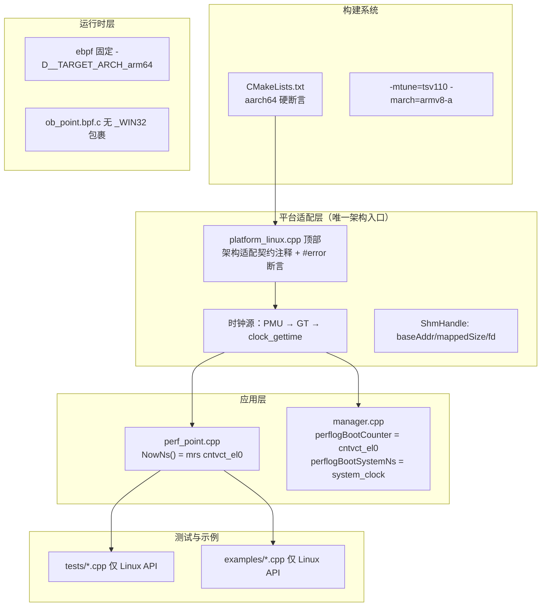
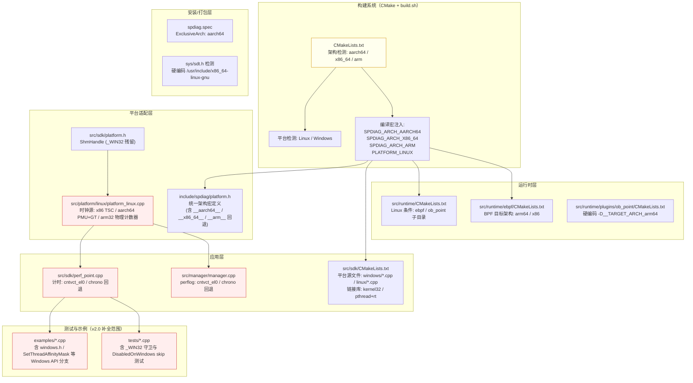
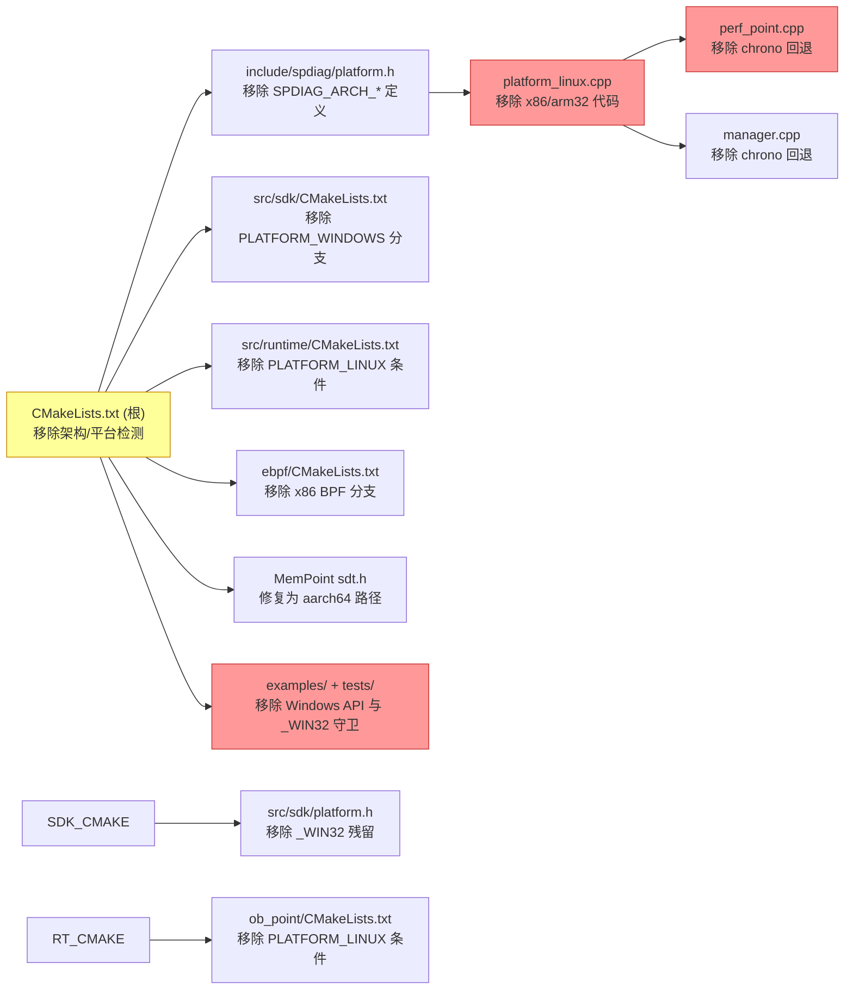
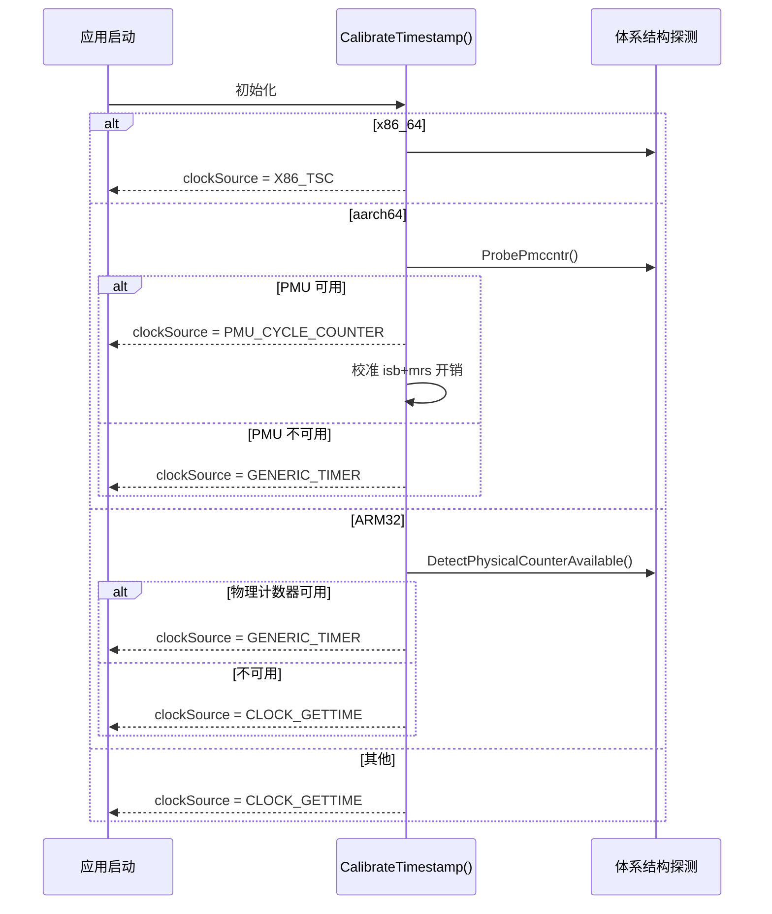
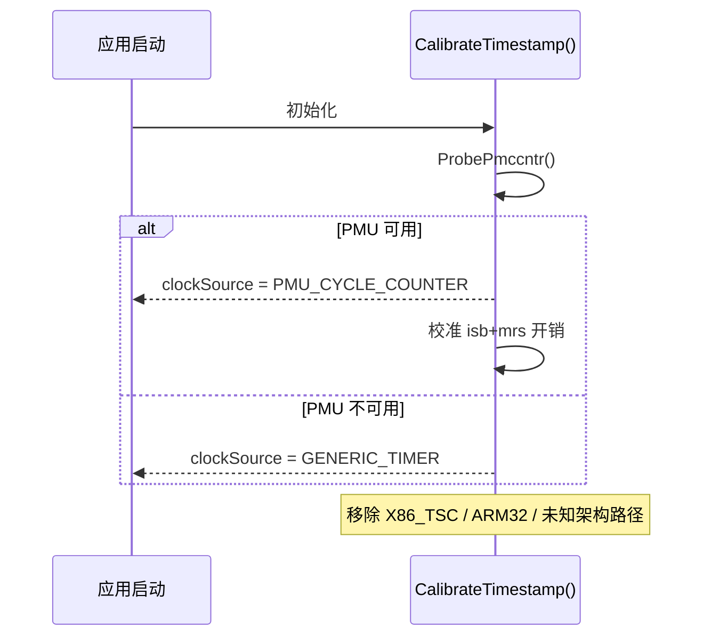
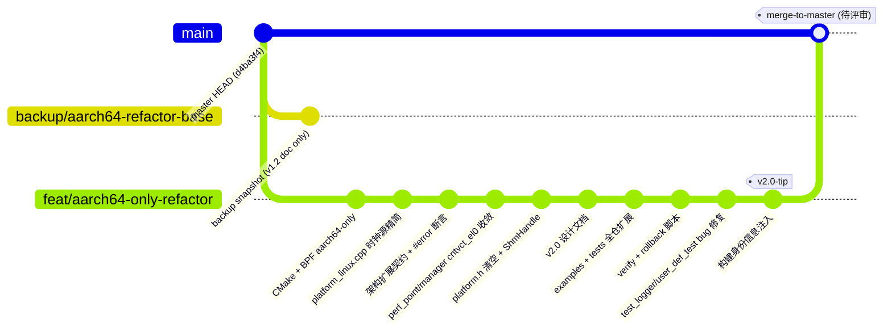

# SpDiag 架构精简方案：仅保留 aarch64 架构支持

> **v2.0，2026-07-20**。本版描述 SpDiag aarch64-only 整改的完整目标架构与全仓整改范围。
> 本文档是**规格/设计文档**，陈述"整改后 SpDiag 应有的形态"，不涉及实施进度。
> 实施进度与验证结果见独立的技术交付文档。

---

## 术语表

| 术语 | 含义 |
|---|---|
| **架构适配层** | 项目中所有 `#ifdef __aarch64__` / `#ifdef __x86_64__` / `#ifdef __arm__` 等预处理器条件分支 |
| **OS 适配层** | 项目中所有 `#ifdef _WIN32` / `#if defined(__APPLE__)` / `PLATFORM_WINDOWS` 等操作系统判断 |
| **SPDIAG_ARCH_*** | CMake 注入的统一架构宏（整改后彻底移除） |
| **PLATFORM_LINUX / PLATFORM_WINDOWS** | CMake 平台变量（整改后移除，因为一定是 Linux） |
| **平台层** | `src/platform/linux/platform_linux.cpp` + `include/spdiag/platform.h` + `src/sdk/platform.h` |
| **时钟源** | PMU Cycle Counter / Generic Timer / clock_gettime（aarch64 上仅保留这三条路径） |

---

## 1. 目标架构

### 1.1 架构原则

整改后 SpDiag 遵循三条原则：

1. **架构唯一**：仅支持 aarch64（ARMv8-A 64 位），构建期硬断言，非 aarch64 编译立即报错
2. **OS 唯一**：仅支持 Linux，所有 OS 判断分支移除，代码直接假设 Linux 环境
3. **接口稳定**：架构适配接口签名（`ReadCycleCounter`/`CalibrateTimestamp`/`GetTimestampNs` 等）保持稳定，为未来扩展其他架构预留契约（见 §10）

### 1.2 支持矩阵

| 模块 | aarch64 | x86_64 | ARM32 | Windows | 说明 |
|---|---|---|---|---|---|
| 构建系统 | ✅ | ❌（编译报错） | ❌ | ❌ | 硬断言 aarch64 |
| 时钟源 | PMU + Generic Timer + clock_gettime | — | — | — | 三级兜底 |
| PerfPoint 计时 | cntvct_el0 | — | — | — | 唯一路径 |
| PerfLog 引导计数 | cntvct_el0 + system_clock | — | — | — | 寄存器读 + wall clock |
| ShmHandle | fd | — | — | — | 仅 Linux 字段 |
| eBPF 目标 | arm64 | — | — | — | 固定 |
| 示例与测试 | Linux API | — | — | — | sched_getcpu/pthread/getpid 等 |

### 1.3 目标架构全景



---

## 2. 整改范围（全仓）

### 2.1 范围边界

整改范围是**全仓所有非 aarch64 架构分支 + 所有非 Linux OS 判断**，包括：

| 维度 | 扫描内容 |
|---|---|
| 架构宏 | `__x86_64__` / `__i386__` / `__amd64__` / `__arm__` / `__thumb__` / `_M_X64` / `_M_ARM` / `_M_IX86` / `x86intrin` / `__rdtsc` / `__TARGET_ARCH_x86` |
| SPDIAG 架构宏 | `SPDIAG_ARCH_AARCH64` / `SPDIAG_ARCH_X86_64` / `SPDIAG_ARCH_ARM` |
| OS 判断 | `_WIN32` / `_MSC_VER` / `MSVC` / `PLATFORM_WINDOWS` / `PLATFORM_LINUX` / `__APPLE__` / `__MINGW` / `__CYGWIN__` |
| Windows API | `windows.h` / `psapi.h` / `intrin.h` / `SetThreadAffinityMask` / `GetCurrentProcessId` / `GetCurrentProcessorNumber` / `GetProcessMemoryInfo` / `PROCESS_MEMORY_COUNTERS` / `SetProcessAffinityMask` |

### 2.2 受影响目录

| 目录 | 受影响文件数 | 整改类型 |
|---|---|---|
| 根 + `src/sdk/` + `src/runtime/` + `src/runtime/ebpf/` + `src/runtime/plugins/ob_point/` | 6 个 CMake | 移除平台/架构检测，硬断言 aarch64 |
| `src/platform/linux/` | 1 个 | 时钟源精简，新增架构契约 |
| `src/sdk/` | 3 个（`perf_point.cpp` / `perf_manager.cpp` 不变 / `platform.h`） | 计时路径收敛 |
| `src/manager/` | 1 个（`manager.cpp`） | perflog 计数路径收敛 |
| `include/spdiag/` | 1 个（`platform.h`） | 清空架构宏 |
| `src/runtime/plugins/ob_point/bpf/` | 1 个（`ob_point.bpf.c`） | 移除 `_WIN32` 包裹 |
| `examples/` | 13 个 `.cpp` | 移除 Windows API 与平台分支 |
| `tests/*.cpp` | 5 个 | 移除 `_WIN32` 守卫与平台分支 |
| `tests/user_def_test/` | 2 个（`CMakeLists.txt` + `main.cpp`） | CMake 移除 `if(MSVC)`；`main.cpp` 修复 `PerfStat` 不可拷贝导致的编译错误（详见 §4.15） |
| `scripts/` | 新增 2 个脚本 + `.gitattributes` | 回退工具 + 验证脚本 + 行尾规范 |

**不受影响**：`src/cli/*`、`src/logger/*`、`src/manager/{aggregator,dump_recorder,persistent_aggr,percentile_calculator}.*`、`src/runtime/{data_pipeline,plugin_manager,processor,probe_manager,shm_reader,symbol_resolver}.*`、`src/sdk/{global_perf_point_factory,mem_point,perf_shard,shm_writer}.*`、`include/spdiag/{perf,mem_point,shm_layout}*.h`、`build.sh`、`spdiag.spec`（`ExclusiveArch: aarch64` 已正确）。

---

## 3. 分支策略

- **整改分支**：`feat/aarch64-only-refactor`，所有改动在此分支
- **不动 master**：整改成果通过 PR 评审合入 master
- **备份分支**：`backup/aarch64-refactor-base`，整改前快照，仅同步设计文档不动代码
- **commit 粒度**：按整改层次拆分原子 commit（CMake / platform / perf / manager / headers / bpf / examples / tests / scripts / docs），每个 commit 自洽可独立编译

---

## 4. 详细改动方案

### 4.1 根 CMakeLists.txt

**目标**：移除平台/架构检测，硬断言 aarch64。

```cmake
# 整改后：替换原 UNIX/Linux 检测 + 三路架构检测为单条硬断言
if(NOT CMAKE_SYSTEM_PROCESSOR MATCHES "aarch64|arm64")
    message(FATAL_ERROR "SpDiag only supports aarch64/arm64. Current: ${CMAKE_SYSTEM_PROCESSOR}")
endif()
```

具体改动：
- 移除 `if(UNIX AND NOT WIN32) set(PLATFORM_LINUX TRUE)` 块
- 移除三路架构检测（`SPDIAG_ARCH_AARCH64/X86_64/ARM`）与宏注入
- `sdt.h` 检测路径从 `/usr/include/x86_64-linux-gnu` 修正为 `/usr/include/aarch64-linux-gnu`，并去除 `PLATFORM_LINUX` 条件
- `ENABLE_MEMPOINT`/`ENABLE_OB_MEMORY`/`ENABLE_OB_CACHE` 去除 `AND PLATFORM_LINUX` 条件
- 移除 `if(MSVC)` 警告选项分支，`-Wall -Wextra -Werror` 直接生效
- `-mtune=tsv110 -march=armv8-a` 移除 `if(SPDIAG_ARCH_AARCH64)` 包裹

### 4.2 src/sdk/CMakeLists.txt

- 平台源文件直取 `../platform/linux/*.cpp`，移除 `PLATFORM_WINDOWS/LINUX` 分支
- 链接库固定 `pthread rt`，移除 `kernel32` 分支
- `target_compile_definitions` 去除 `PLATFORM_LINUX` 条件
- **保留** `target_compile_options(spdiag_lib PUBLIC -Wno-stringop-overflow)`（GCC12 aarch64 对 `GlobalAccum` 的 `-Wstringop-overflow` 误报 workaround）

### 4.3 src/runtime/CMakeLists.txt

移除 `if(PLATFORM_LINUX)` 外层包裹，`add_subdirectory(ebpf)` 与 `add_subdirectory(plugins/ob_point)` 直接执行。

### 4.4 src/runtime/ebpf/CMakeLists.txt

- 移除 `if(PLATFORM_LINUX)` 外层与 `else()` 空壳回退库块
- 架构映射固定 `set(BPF_TARGET_ARCH "-D__TARGET_ARCH_arm64")`，移除三路推导

### 4.5 src/runtime/plugins/ob_point/CMakeLists.txt

移除 `if(PLATFORM_LINUX)` 包裹。已有的 `-D__TARGET_ARCH_arm64` 硬编码符合目标，无需修改。

### 4.6 include/spdiag/platform.h

**实际状态**：该文件无任何 `.cpp/.h` 直接 `#include`（孤儿文件），但 CMake `install(DIRECTORY include/spdiag ...)` 会随目录打包发布给下游，故**保留文件骨架不删**。

整改：清空历史上三组 `SPDIAG_ARCH_*` 宏定义（`AARCH64`/`X86_64`/`ARM` 的 `#ifdef`/`#elif` 块），仅保留版权头 + `#pragma once` + 说明注释。注释指向真正的架构适配入口 `src/platform/linux/platform_linux.cpp`。

### 4.7 src/sdk/platform.h

`ShmHandle` 结构移除 `#ifdef _WIN32` 分支与 `fileMapping` 成员，仅保留 Linux 字段：

```cpp
struct ShmHandle {
    void*    baseAddr   = nullptr;
    size_t   mappedSize = 0;
    int      fd         = -1;
};
```

### 4.8 src/platform/linux/platform_linux.cpp（架构适配核心）

本文件是 SpDiag 的**唯一架构适配入口**，整改后包含：

**顶部**：架构适配层契约注释 + 编译期断言（详见 §10 架构扩展预留）

**时钟源枚举**（移除 `X86_TSC`）：
```cpp
enum class ClockSource : uint8_t {
    CLOCK_GETTIME      = 0,
    GENERIC_TIMER      = 1,
    PMU_CYCLE_COUNTER  = 2,
};
```

**aarch64 探测/读取函数**（移除 `#if defined(__aarch64__)` 包裹，直接存在）：
- `ProbePmccntr()` — SIGILL/SIGSEGV 信号保护下探测 PMU 可读性
- `ReadPmccntr()` — `isb; mrs pmccntr_el0`
- `ReadCntvct()` — `isb; mrs cntvct_el0`
- `isbOverhead` 全局变量（移除 `#ifdef` 包裹）

**删除的非 aarch64 代码**：
- `<x86intrin.h>` include
- ARM32 `DetectPhysicalCounterAvailable()` 与 `mrrc p15` 读取
- `ClockGetTimeNs()`（与 `ClockGetTimeNsRaw()` 重复，aarch64 不需要）

**`ReadCycleCounter()`**：4 路 `#if` 分支收敛为单一 switch：
```cpp
static inline uint64_t ReadCycleCounter() {
    switch (clockSource) {
        case ClockSource::PMU_CYCLE_COUNTER: return ReadPmccntr();
        case ClockSource::GENERIC_TIMER:     return ReadCntvct();
        default:                             return ClockGetTimeNsRaw();
    }
}
```

**`CalibrateTimestamp()`**：时钟源探测由 4 路 `#if` 简化为 PMU 探测 → GT 兜底：
```cpp
if (ProbePmccntr()) {
    clockSource = ClockSource::PMU_CYCLE_COUNTER;
} else {
    clockSource = ClockSource::GENERIC_TIMER;
}
```

isb 开销校准逻辑移除 `#if defined(__aarch64__)` 包裹。

**保留**：`ClockGetTimeNsRaw()`（`CLOCK_MONOTONIC_RAW`）作为 PMU/GT 均不可用时的兜底，确保功能不中断。

### 4.9 src/sdk/perf_point.cpp

5 处 `#if defined(__aarch64__)` 条件块的处理：

| 位置 | 改动 |
|---|---|
| `NowNs()`/`GetFreq()`/`g_timerFreq` 定义块 | 移除 `#if`/`#else chrono 回退`/`#endif`，仅保留 aarch64 寄存器读取 |
| 构造函数（本地点/全局点）`nsPerTick_` Q32 初始化 | 移除两处 `#if defined(__aarch64__)` 包裹 |
| `End()` 全局路径 tick→ns 转换 | 移除 `#if defined(__aarch64__)` 包裹 |
| `End()` 分片路径 tick→ns 转换 | 移除 `#if defined(__aarch64__)` 包裹 |

**附带清理**：移除已无使用者的 `#include <chrono>`。

**保留**：
- `LIKELY`/`UNLIKELY` 宏的 `#if defined(__GNUC__) || defined(__clang__)`（编译器宏，非架构条件，aarch64 GCC/Clang 下恒成立）
- `SPDIAG_ENABLE_PERCENTILE`/`SPDIAG_ENABLE_PERFLOG` 功能开关（CMake 选项控制，非架构条件）

### 4.10 src/manager/manager.cpp

`#ifdef SPDIAG_ENABLE_PERFLOG` 块内 `#if defined(__aarch64__)` 二选一：

```cpp
#ifdef SPDIAG_ENABLE_PERFLOG
    hdr.perflogEnabled = config.perflogStart ? 1 : 0;
    if (config.perflogStart) {
        uint64_t cntvct, cntfrq;
        __asm__ volatile("mrs %0, cntvct_el0" : "=r"(cntvct));
        __asm__ volatile("mrs %0, cntfrq_el0" : "=r"(cntfrq));
        hdr.perflogBootCounter = cntvct;
        hdr.perflogTimerFreq = cntfrq;
        hdr.perflogBootSystemNs = std::chrono::duration_cast<std::chrono::nanoseconds>(
            std::chrono::system_clock::now().time_since_epoch()).count();
    } else {
        hdr.perflogBootCounter = 0;
        hdr.perflogBootSystemNs = 0;
        hdr.perflogTimerFreq = 0;
    }
#endif
```

**关键保留**：
- 删除 `#else` 分支的 `steady_clock` perflogBootCounter 回退
- **保留** `hdr.perflogBootSystemNs` 的 `system_clock` 赋值 — 此调用在 `#endif` 之外、`PERFLOG` 块之内，跨架构合法（系统挂钟时间，不依赖 CPU 寄存器）。删除会导致 perflog 系统启动时间字段丢失
- `#include <chrono>` 因 `system_clock` 仍在用而保留

### 4.11 src/runtime/plugins/ob_point/bpf/ob_point.bpf.c

整改：删除 L1 `#ifndef _WIN32` 与文件末尾 `#endif`，让整个 BPF 程序无条件编译。

理由：BPF 程序只在 Linux 下由 `clang -target bpf` 编译，`_WIN32` 包裹是冗余保护。整改后该文件直接以 `#include <linux/bpf.h>` 开头。

### 4.12 examples/*.cpp（13 个文件）

examples 是 aarch64 验证的被测目标与示例代码，整改后仅保留 Linux API 调用。

**受影响文件**：
- `demo_app.cpp` / `demo_app_concurrent.cpp` / `demo_app_concurrent_init_per_loop.cpp` / `demo_app_unbound.cpp` / `demo_global_perfpoint.cpp`
- `benchmark_memory.cpp` / `benchmark_start_stop_overhead.cpp` / `benchmark_time.cpp`
- `cachestat_demo.cpp` / `memstat_demo.cpp` / `mempoint_demo.cpp`（整文件包裹模式）
- `csv_export_demo.cpp`
- `test_conflict.cpp`

**整改模式**：

1. **include 块**：`#ifdef _WIN32 <windows.h> [<psapi.h>|<intrin.h>] #else <linux headers> #endif` → 删除 Windows 头文件，保留 `<sched.h>`/`<unistd.h>`/`<pthread.h>`/`<fstream>` 等 Linux 头文件

2. **函数二选一**：`#ifdef _WIN32 {Win实现} #else {Linux实现} #endif` → 删除 Windows 实现与条件，保留 Linux 实现。涉及函数：
   - `SetAffinity()` / `BindToCore()` / `UnbindFromCore()` — `SetThreadAffinityMask` → `sched_setaffinity`/`pthread_setaffinity_np`
   - `GetCurrentCoreId()` — `GetCurrentProcessorNumber` → `sched_getcpu`
   - `GetProcessMemoryKB()` — `GetProcessMemoryInfo`/`PROCESS_MEMORY_COUNTERS` → `/proc/self/status` 解析
   - `SetProcessAffinityTo4Cores()` — `SetProcessAffinityMask` → `sched_setaffinity`

3. **单语句二选一**（`csv_export_demo.cpp`）：`GetCurrentProcessId()` → `getpid()`

4. **整文件包裹**（`cachestat_demo`/`memstat_demo`/`mempoint_demo`）：删除开头 `#ifndef _WIN32` 与末尾 `#else // _WIN32 <Windows占位main> #endif`，保留中间完整 Linux 实现。**注意保留内层 `SPDIAG_ENABLE_MEMPOINT` 等功能宏**

5. **保留**：`benchmark_*.cpp` 里基于 `__GNUC__`/`__clang__` 的编译器宏（如 `SPDIAG_COMPILER_BARRIER`），非架构条件

### 4.13 tests/*.cpp（5 个文件）

**受影响文件**：`test_cachestat_plugin.cpp` / `test_mempoint_plugin.cpp` / `test_memstat_plugin.cpp` / `test_ob_bpf_context.cpp` / `test_symbol_resolver.cpp`

**整改模式**：

1. **4 个 plugin 测试**（cachestat/mempoint/memstat/ob_bpf_context）同构：
   - include 守卫 `#ifndef _WIN32 #ifdef SPDIAG_ENABLE_* #include ... #endif #endif` → 简化为 `#ifdef SPDIAG_ENABLE_* #include ... #endif`
   - 测试体守卫 `#if !defined(_WIN32) && defined(SPDIAG_ENABLE_*)` → 简化为 `#if defined(SPDIAG_ENABLE_*)`
   - 删除 `#else <DisabledOnWindowsOrNotCompiled GTEST_SKIP> #endif` 分支

2. **test_symbol_resolver.cpp**（5 处 `_WIN32`）：
   - `#ifndef _WIN32 #include <unistd.h> #endif` → 直接 `#include <unistd.h>`
   - `#ifndef _WIN32 namespace { SomeLocalFunction } #endif` → 移除包裹
   - 4 个 `TEST` 体里的 `#ifdef _WIN32 EXPECT_FALSE(...) #else {Linux验证} #endif` → 仅保留 Linux 验证

### 4.14 docs/architecture/

设计文档（本文件、v1.1、v1.2）中出现的 `_WIN32` 等字样属**整改对象的客观陈述**（描述"v1.1 当时的状态"或"整改目标"），保留作历史与对照，不在 grep 残留检查范围内。

### 4.15 tests/user_def_test/（整改遗漏补全）

`user_def_test` 是验证"下游用户通过 `find_package(SpDiag)` 集成 SDK"场景的独立 CMake 项目，编译时用 `/usr/local/include/spdiag/`（install 后的系统头文件，非仓库源码）。整改中遗漏，本次补全。

#### 4.15.1 tests/user_def_test/CMakeLists.txt

**问题**：含与根 CMake 同款的 `if(MSVC)` 死分支。

```cmake
# 整改前
if(MSVC)
    add_compile_options(/W4 /WX)
else()
    add_compile_options(-Wall -Wextra -Werror)
endif()

# 整改后
add_compile_options(-Wall -Wextra -Werror)
```

#### 4.15.2 tests/user_def_test/main.cpp（PerfStat 拷贝构造 bug）

**问题**：`getAggregatedStat` 函数按值返回 `PerfStat`，但 `PerfStat` 含 `std::atomic` 字段（不可拷贝构造），在 GCC 12 aarch64 `-Werror` 下编译失败：

```
error: use of deleted function 'SpDiag::PerfStat::PerfStat(const SpDiag::PerfStat&)'
note: 'std::atomic<unsigned int>::atomic(const std::atomic<unsigned int>&)' is deleted
```

**修复**：改为 out 参数模式。函数签名 `static PerfStat getAggregatedStat(uint32_t idx)` → `static void getAggregatedStat(uint32_t idx, PerfStat& result)`，函数内首行 `result.reset()` 防止累加脏值。8 处调用点统一改为：

```cpp
// 整改前
auto s = getAggregatedStat(sid(PerfKey::USER_LOGIN));

// 整改后
PerfStat s;
getAggregatedStat(sid(PerfKey::USER_LOGIN), s);
```

> 此 bug 与 aarch64 整改无直接关系（任何架构下 `PerfStat` 都不可拷贝），但此前 user_def_test 未在 aarch64 上编译过，整改的 aarch64 实机验证首次暴露。

### 4.16 scripts/ 与仓库基础设施（整改配套）

整改配套工具与基础设施：

| 文件 | 用途 |
|---|---|
| `scripts/aarch64_refactor_rollback.sh` | 一键回退工具（status/patch/revert/verify 四子命令，默认 dry-run，工作区不干净时拒绝执行） |
| `scripts/verify_aarch64_refactor.sh` | 全量验证 + CSV 落盘脚本（check/build/test/functional/all 五子命令） |
| `.gitattributes` | 强制 `*.sh`/`*.cmake`/`CMakeLists.txt`/`*.cpp`/`*.h`/`*.bpf.c`/`build.sh`/`*.spec`/`*.md` 使用 LF 行尾，跨平台规范化 |

**两个 shell 脚本的权限位**：commit 里必须记录为 `100755`（可执行）。`git update-index --chmod=+x` 用于把权限位写入 git，避免 fetch 后 `permission denied`。

**verify 脚本的 `set -e` 陷阱**：脚本里 `parse_args` 末尾**禁止**用 `[ -z "${VAR}" ] && die "..."` 模式——在 `set -euo pipefail` 下，当 `VAR` 非空时 `[ -z ]` 返回 false，整个 `test && cmd` 表达式返回非零，触发 `set -e` 立即退出脚本。必须改为 `if [ -z "${VAR}" ]; then die "..."; fi`。rollback 脚本里的 `[ ... ] && { cmd; exit 0; }` 因有 `exit 0` 保证退出码为 0，安全。

---

## 5. 接口变更

### 5.1 删除的接口

| 文件 | 删除项 |
|---|---|
| `platform_linux.cpp` | `<x86intrin.h>` include、`__rdtsc()` 调用、`DetectPhysicalCounterAvailable()`、`ClockGetTimeNs()`、`ClockSource::X86_TSC` |
| `perf_point.cpp` | chrono 回退 `NowNs()`、chrono `nsPerTick_` 初始化分支、孤立 `#include <chrono>` |
| `manager.cpp` | chrono steady_clock perflog 计数器分支 |
| `platform.h (include)` | 全部 `SPDIAG_ARCH_*` 宏定义 |
| `ob_point.bpf.c` | `#ifndef _WIN32` 包裹 |
| `examples/*.cpp` | `windows.h`/`psapi.h`/`intrin.h` include、所有 Windows API 函数与分支 |
| `tests/*.cpp` | `_WIN32` 守卫、Windows skip 测试占位 |

### 5.2 保留并简化的接口

| 文件 | 接口 | 变更 |
|---|---|---|
| `platform_linux.cpp` | `ClockGetTimeNsRaw()` | 保留（PMU/GT 兜底） |
| `platform_linux.cpp` | `ReadCycleCounter()` / `CalibrateTimestamp()` | 4 路 → 2 路 |
| `platform_linux.cpp` | `ProbePmccntr/ReadPmccntr/ReadCntvct` | 移除 ifdef 包裹 |
| `perf_point.cpp` | `NowNs()`/`GetFreq()`/`g_timerFreq` | 移除 ifdef 包裹 |
| `manager.cpp` | `perflogBootSystemNs` | 保留（system_clock wall clock） |
| `src/sdk/CMakeLists.txt` | `-Wno-stringop-overflow` | 保留（GCC12 误报 workaround） |
| `examples/*.cpp` | `LIKELY`/`UNLIKELY`、`SPDIAG_COMPILER_BARRIER` 等编译器宏 | 保留（非架构条件） |

---

## 6. 风险与验证

### 6.1 风险矩阵

| 风险 | 影响 | 缓解 |
|---|---|---|
| 删 `platform.h` 架构宏后外部依赖失效 | 编译失败 | grep `SPDIAG_ARCH_` 全仓确认无引用 |
| `ob_point.bpf.c` 移除包裹后 BPF 编译失败 | eBPF 不可用 | 整改后跑完整 build |
| `sdt.h` 路径改 aarch64 后找不到 | MemPoint 静默禁用 | 检查 cmake configure `HAS_SDT_H=TRUE` |
| `manager.cpp` 漏写 perflogBootSystemNs | perflog 系统时间丢失 | 保留 system_clock 赋值 |
| examples/tests 移除 Windows 分支时 `#if/#endif` 失配 | 编译失败 | 每文件 `#if/#endif` 配对验证 |
| 全仓残留非 aarch64 宏 | 架构混合，运行时崩溃 | §6.3 全架构+全 OS 扫描 |
| PMU 在虚拟化/容器不可用 | 计时精度下降 | GT 兜底路径保留 |

### 6.2 验证步骤

| 步骤 | 命令 | 通过标准 |
|---|---|---|
| 编译 | `bash build.sh -l on -s on -m on -t on` | 0 error |
| 链接 | `ldd build/spdiag` | 无缺失 .so |
| 单元测试 | `cd build && ctest --output-on-failure` | 全 PASSED |
| 功能验证 | `scripts/verify_aarch64_refactor.sh all` | 所有 CLI 命令产出 CSV |
| 残留扫描 | 见 §6.3 | 全部无匹配 |
| 回退演练 | `scripts/aarch64_refactor_rollback.sh revert --apply` + `verify` | 回到基线 |

### 6.3 残留检查命令（全架构 + 全 OS）

```bash
# 1. Windows / MSVC 残留
grep -rn "_WIN32\|_MSC_VER\|MSVC\|PLATFORM_WINDOWS\|PLATFORM_LINUX" \
     --include='*.cpp' --include='*.h' --include='*.c' \
     src/ include/ examples/ tests/ CMakeLists.txt

# 2. x86 / i386 / amd64 架构宏
grep -rn "__x86_64__\|__i386__\|__amd64__\|_M_X64\|_M_IX86\|x86intrin\|__rdtsc\|__TARGET_ARCH_x86" \
     --include='*.cpp' --include='*.h' --include='*.c' \
     src/ include/ examples/ tests/

# 3. ARM32 架构宏
grep -rn "__arm__\|__thumb__\|_M_ARM\b" \
     --include='*.cpp' --include='*.h' --include='*.c' \
     src/ include/ examples/ tests/

# 4. SPDIAG 架构宏（CMake 不再注入）
grep -rn "SPDIAG_ARCH_X86_64\|SPDIAG_ARCH_ARM\|SPDIAG_ARCH_AARCH64" \
     --include='*.cpp' --include='*.h' --include='*.c' --include='CMakeLists.txt' \
     src/ include/ examples/ tests/

# 5. Windows 专属 API
grep -rn "SetThreadAffinityMask\|GetCurrentProcessId\|GetCurrentProcessorNumber\|GetProcessMemoryInfo\|PROCESS_MEMORY_COUNTERS\|SetProcessAffinityMask" \
     --include='*.cpp' --include='*.h' \
     src/ include/ examples/ tests/

# 6. 其它 OS 判断
grep -rn "__APPLE__\|__MINGW\|__CYGWIN__\|__BSD__\|__darwin" \
     --include='*.cpp' --include='*.h' --include='*.c' \
     src/ include/ examples/ tests/

# 7. sdt.h x86_64 硬编码路径
grep -rn "x86_64-linux-gnu" CMakeLists.txt src/

# 8. 孤儿函数残留
grep -rn "DetectPhysicalCounterAvailable\|ClockGetTimeNs[^R]" src/ include/

# 9. MSVC 死分支（应仅 docs/ 里有描述性引用，src/tests/examples 不应有）
grep -rn "if(MSVC)\|if (MSVC)" --include='*.cmake' --include='CMakeLists.txt' \
     . 2>/dev/null | grep -v '.git/\|/build/\|/third_party/\|^docs/'

# 10. 脚本权限位（必须 100755）
git ls-files -s scripts/*.sh | grep -v '^100755'
# 无输出 = 全部可执行

# 11. 行尾规范（应存在 .gitattributes 强制 LF）
test -f .gitattributes && echo "✓ .gitattributes exists" || echo "✗ .gitattributes MISSING"
```

预期结果：1-9 全部无匹配；10 无输出；11 输出 ✓。

### 6.4 配对完整性检查

```bash
# 每个改动文件的花括号必须配平
for f in $(find src/ include/ examples/ tests/ -name '*.cpp' -o -name '*.h'); do
    o=$(tr -cd '{' < "$f" | wc -c)
    c=$(tr -cd '}' < "$f" | wc -c)
    [ "$o" != "$c" ] && echo "MISMATCH: $f {$o vs }$c"
done

# 每个改动文件的 #if/#endif 必须配对
for f in $(find src/ include/ examples/ tests/ -name '*.cpp' -o -name '*.h'); do
    ifs=$(grep -c '^#if\|^#ifdef\|^#ifndef' "$f")
    ends=$(grep -c '^#endif' "$f")
    [ "$ifs" != "$ends" ] && echo "MISMATCH: $f #if=$ifs #endif=$ends"
done
```

---

## 7. 改动统计

| 类别 | 文件数 | 说明 |
|---|---|---|
| CMake 构建 | 5 | 根 + sdk + runtime + ebpf + ob_point |
| C++ 头文件 | 2 | `include/spdiag/platform.h` + `src/sdk/platform.h` |
| C++ 核心源文件 | 3 | `platform_linux.cpp` + `perf_point.cpp` + `manager.cpp` |
| BPF C 源文件 | 1 | `ob_point.bpf.c` |
| examples | 13 | 13 个 `.cpp` 移除 Windows API 与平台分支 |
| tests | 5 | 5 个 `.cpp` 移除 `_WIN32` 守卫 |
| 新增脚本 | 2 | `aarch64_refactor_rollback.sh` + `verify_aarch64_refactor.sh` |
| 新增文档 | 1 | 本 v2.0 设计文档 |
| **合计** | **32** | — |

---

## 8. 交付物

| # | 交付物 | 说明 |
|---|---|---|
| 1 | `feat/aarch64-only-refactor` 分支的原子 commit 序列 | 按 §3 拆分 |
| 2 | 本 v2.0 设计文档 | 规格/设计，陈述目标形态 |
| 3 | v1.1 / v1.2 历史文档 | 保留作演进对照 |
| 4 | `scripts/aarch64_refactor_rollback.sh` | 一键回退工具 |
| 5 | `scripts/verify_aarch64_refactor.sh` | 全量验证 + CSV 落盘脚本 |
| 6 | 技术交付文档（验证完成后单独编写） | 实施进度、验证结果、偏差记录 |

---

## 9. 回滚

详见 `scripts/aarch64_refactor_rollback.sh` 实现。三级回滚策略：

1. **一键整体回退**：`./scripts/aarch64_refactor_rollback.sh revert --apply`（生成 patch → `git apply -R`）
2. **按 commit 精确回退**：`git revert <sha>`（保留历史，生成反向 commit）
3. **整分支重置**：`git reset --hard <baseline>`（最后手段，需 force push）

基线 commit：`d4ba3f4`（`!65 merge feat_spdiag_log_test into master`）。

---

## 10. 架构扩展预留

### 10.1 设计决策：不另起抽象层

SpDiag 未来可能扩展到其他架构（x86 回归、RISC-V 等）。是否需要在整改时另建架构抽象层（虚函数 / 工厂 / 编译时 trait）？

**结论：不需要另起抽象层。** 整改后的 `platform_linux.cpp` 接口签名本身就是天然的架构基础。整改过程"删实现分支、不动接口签名"，等于**隐式地把这个接口层固化下来了**。

### 10.2 对外稳定的接口清单

以下函数签名整改后保持不变，构成架构适配契约：

| 接口 | 语义 |
|---|---|
| `ReadCycleCounter()` | 读取单调递增的硬件周期计数 |
| `CalibrateTimestamp()` | 启动期校准 `nsPerTickQ32` 与时钟源选择 |
| `GetTimestampNs()` | 返回当前单调纳秒时间戳 |
| `ProbePmccntr()` | 探测 PMU cycle counter 是否 EL0 可读 |
| `ReadPmccntr()` / `ReadCntvct()` | 读取 aarch64 PMU/Generic Timer 寄存器 |
| `TicksToNs()` | tick→ns 的 Q32 定点转换（架构无关） |

### 10.3 落地：契约注释 + 编译期断言

`platform_linux.cpp` 顶部（版权头之后、include 之前）：

```cpp
// 架构适配层契约（aarch64-only 整改后保留）
// 本文件是 SpDiag 的唯一架构适配入口，定义一组架构无关的调用接口：
//   接口（对外稳定）: ReadCycleCounter/CalibrateTimestamp/GetTimestampNs/...
//   当前实现（aarch64）: PMU_CYCLE_COUNTER → GENERIC_TIMER → CLOCK_GETTIME
//   扩展新架构时的步骤:
//     1. 新建 src/platform/<os>/<arch>/platform_<arch>.cpp，实现上述接口
//     2. 修改 src/sdk/CMakeLists.txt 按目标架构选择 platform 源文件
//     3. 在根 CMakeLists.txt 调整 aarch64 硬断言为多架构分发
//     4. 若新架构需要 Q32 定点之外的 tick→ns 转换，参考 TicksToNs()

#if !defined(__aarch64__)
#error "SpDiag 当前仅支持 aarch64 架构。如需扩展新架构，请按本文件顶部契约实现 platform 接口。"
#endif
```

### 10.4 方案对比

| 方案 | 优点 | 缺点 | 选用 |
|---|---|---|---|
| 另起抽象层（虚函数/工厂） | 形式正规 | 运行时虚调用开销（SpDiag 热路径）；过度设计 | ❌ |
| 编译时 trait（CRTP） | 零开销 | 复杂度高，当前规模不值得 | ❌ |
| **接口签名稳定 + `#error` 断言** | 零运行时成本；自文档化；编译报错直接指向契约 | 形式非正式 | ✅ |

SpDiag 是性能诊断工具，热路径（`PerfPoint::End()`）每次调用都走 `NowNs()` — 任何运行时虚调用开销都不可接受。接口签名稳定 + `#error` 断言是当前规模与性能约束下的最优解。

### 10.5 BPF 架构宏约定（`__TARGET_ARCH_arm64` 不是"待删除残留"）

整改后 `__TARGET_ARCH_arm64` 仍保留在两处 CMake：

| 文件 | 行 | 内容 |
|---|---|---|
| `src/runtime/ebpf/CMakeLists.txt` | `set(BPF_TARGET_ARCH "-D__TARGET_ARCH_arm64")` | 固定值，clang `-target bpf` 编译 BPF 程序时传入 |
| `src/runtime/plugins/ob_point/CMakeLists.txt` | `-D__TARGET_ARCH_arm64` 硬编码 | 同上 |

**这不是"指定架构需删除"的残留**——`__TARGET_ARCH_*` 是 Linux BPF 工具链的标准约定：内核工具集 `tools/lib/bpf/bpf_tracing.h` 用它区分 BPF 程序的目标架构（`__TARGET_ARCH_arm64` = ARMv8-A 64 位 = aarch64）。整改后 SpDiag 只支持 aarch64，所以固定为 `__TARGET_ARCH_arm64` 是正确的，等同于"固定 aarch64"。

整改清掉的是 `__TARGET_ARCH_x86`（三路架构推导里的 x86 分支）和 `if(CMAKE_SYSTEM_PROCESSOR MATCHES ...)` 推导逻辑，**不是** `__TARGET_ARCH_arm64` 本身。

**注意区分**：
- ❌ `__TARGET_ARCH_x86` — 已清零（非 aarch64 BPF 目标）
- ✅ `__TARGET_ARCH_arm64` — 保留（BPF 工具链对 aarch64 的标准标识）

---

## 11. 在 aarch64 openEuler 主机上验证

整改验证要求在 aarch64 / openEuler 24.03 LTS-SP4 主机上进行。下面用占位符描述流程，实际值由操作者按所在环境填写：

- `${WORKDIR}`：操作者用户家目录下的工作根目录（例：`/home/<user>/spdiag-arm64`）
- `${PROXY}`：可选的下载代理（如内网 squid 地址）。无代理环境可省略 `export https_proxy`。

### 11.1 工作模式

操作者在 aarch64 主机的终端上执行下方命令，输出回传给设计/评审方。任务边界：只验证 SpDiag，不动其它项目工作区；不修改/推送 master；只在 `feat/aarch64-only-refactor` 分支操作。

### 11.2 验证流程

```bash
# 1. 拉代码到独立目录（避开其它项目工作区）
mkdir -p "${WORKDIR}" && cd "${WORKDIR}"
export https_proxy="${PROXY}"   # 无代理则省略
git clone --single-branch --branch feat/aarch64-only-refactor \
         https://atomgit.com/liusiyu60/spdiag.git spdiag
cd spdiag

# 2. 装依赖
sudo dnf install -y cmake gcc-c++ clang libbpf-devel bpftool libelf-devel \
                   zlib-devel systemtap-sdt-devel python3

# 3. 一键验证（编译 + ctest + 全量功能 + CSV 落盘）
./scripts/verify_aarch64_refactor.sh all

# 4. 失败时回退
./scripts/aarch64_refactor_rollback.sh revert --apply
```

`verify_aarch64_refactor.sh all` 会：
- 编译（`build.sh -l on -s on -m on -t on`）
- 跑 ctest
- 启动 SHM、起 `demo_app -d 0` 当被测目标（产生 PerfPoint 数据让 `show`/`history` 有内容，产生内存/缓存活动让 `memstat`/`cachestat` 有数据）
- 依次跑 `show`/`show -d`/`watch`/`history`/`memstat`/`cachestat`，每条命令的输出加 `--csv` 落盘到时间戳目录
- 生成 CSV 清单并打包

被测目标说明：仓库自带 `examples/demo_app.cpp`（9 个工作线程：矩阵乘/素数/IO/内存分配/缓存压力），编译产物 `build/demo_app`，支持 `-d 0` 无限长跑，是 SpDiag 验证的理想被测目标（自带 PerfPoint 打点）。

---

## 附录 A：可视化对照（整改前后形态对比）

本附录提供整改前后的可视化对照，帮助新读者理解整改的动机与效果。

### A.1 整改前：当前架构全景（多架构/多 OS 混杂）



### A.2 整改前：架构支持矩阵（多架构/多 OS 混杂）

| 模块 | aarch64 | x86_64 | ARM32 | Windows | 判定方式 |
|---|---|---|---|---|---|
| 构建系统 | ✅ | ✅ | ✅ | ❌ (PLATFORM_LINUX 要求) | `CMAKE_SYSTEM_PROCESSOR` |
| platform.h 宏 | ✅ | ✅ | ✅ | — | `__aarch64__` / `__x86_64__` 等 |
| 时钟源 | PMU + GT | TSC | 物理计数器 | — | `#if defined(__aarch64__)` 等 |
| perf_point 计时 | cntvct_el0 | chrono 回退 | — | — | `#if defined(__aarch64__)` |
| manager perflog | cntvct_el0 | chrono 回退 | — | — | `#if defined(__aarch64__)` |
| ShmHandle | fd (Linux) | fd (Linux) | — | fileMapping (残留) | `#ifdef _WIN32` |
| eBPF 目标 | arm64 | x86 | ❌ | — | `CMAKE_SYSTEM_PROCESSOR` |
| RPM 打包 | ✅ | ❌ (排除) | ❌ (排除) | — | `ExclusiveArch: aarch64` |
| BPF 头文件路径 | aarch64-linux-gnu | 硬编码 x86_64 | — | — | 硬编码路径 |
| examples/tests | Linux API | Linux API | — | Windows API 残留 | `#ifdef _WIN32` |

### A.3 文件改动级联依赖图

整改并非孤立修改，文件间有依赖关系。下图展示改动如何从 CMake 根向下传导到各层：



### A.4 `CalibrateTimestamp()` 时钟源选择简化对比

整改最核心的语义变化是时钟源选择从 4 路 `#if` 简化为 2 路。

**整改前（4 路分支）：**



**整改后（仅 aarch64 两路）：**



### A.5 `platform_linux.cpp` 精简前后对比

ASCII 类图直观展示文件内部结构的精简。

**整改前（4 种架构并存）：**

```
┌─────────────────────────────────────┐
│        platform_linux.cpp           │
├─────────────────────────────────────┤
│ #if __x86_64__                      │
│   #include <x86intrin.h>            │
│   __rdtsc() → ReadCycleCounter()    │
│ #endif                              │
│                                     │
│ #if __aarch64__                     │
│   ProbePmccntr()                    │
│   ReadPmccntr()                     │
│   ReadCntvct()                      │
│   isbOverhead 校准                  │
│ #endif                              │
│                                     │
│ #if __arm__                         │
│   DetectPhysicalCounterAvailable()  │
│   mrrc p15 计数器读取               │
│ #endif                              │
│                                     │
│ #if 其他                            │
│   ClockGetTimeNs()                  │
│ #endif                              │
│                                     │
│ ReadCycleCounter() [4 路分支]       │
│ CalibrateTimestamp() [4 路分支]     │
└─────────────────────────────────────┘
```

**整改后（仅 aarch64）：**

```
┌─────────────────────────────────────┐
│        platform_linux.cpp           │
├─────────────────────────────────────┤
│ // 架构适配层契约注释               │
│ #if !defined(__aarch64__)           │
│   #error "..."                      │
│ #endif                              │
│                                     │
│ #include <signal.h>                 │
│ #include <setjmp.h>                 │
│                                     │
│ ProbePmccntr()                      │
│ ReadPmccntr()                       │
│ ReadCntvct()                        │
│ isbOverhead 校准                    │
│                                     │
│ ClockSource: PMU / GT / CLOCK_GETTIME│
│ ReadCycleCounter() [2 路: PMU / GT] │
│ CalibrateTimestamp() [2 路: PMU/GT] │
└─────────────────────────────────────┘
```

### A.6 分支结构

整改的分支拓扑与 commit 序列：



---

## 12. 版本记录

| 版本 | 日期 | 变更 |
|---|---|---|
| v1.0 | 2026-07-16 | 初版 |
| v1.1 | 2026-07-16 | 14 项自评审修正 |
| v1.2 | 2026-07-20 | 基于 master 全量源码核对，修正 7 项事实错误与遗漏；新增架构扩展预留 |
| v2.0 | 2026-07-20 | 重写为纯净规格文档（不涉实施进度）；扩展整改范围到全仓 examples+tests+docs；新增完整架构宏与 OS 判断扫描清单；新增 §6.4 配对完整性检查；新增 §11 在 aarch64 主机上的验证流程 |
| **v2.0（修订）** | **2026-07-20** | **基于 aarch64 实机验证反馈的大修：**<br>1. §2.2 / §4.15：补 `tests/user_def_test/` 整改（CMake `if(MSVC)` 死分支 + `main.cpp` 的 `PerfStat` 不可拷贝 bug，改为 out 参数）<br>2. §4.16：补 scripts 配套工具与基础设施说明（rollback/verify 脚本、`.gitattributes`、权限位 100755、set -e 陷阱规避）<br>3. §6.3：补 MSVC 死分支、脚本权限位、`.gitattributes` 三项残留检查<br>4. §10.5：补充 `__TARGET_ARCH_arm64` 的 BPF 工具链标准约定说明（区分 `__TARGET_ARCH_x86` 已清零 vs `arm64` 保留）<br>5. §11.2：验证流程改为占位符形式（`${WORKDIR}`/`${PROXY}`），去除任何具体机器标识 |
| **v2.0（再次修订）** | **2026-07-20** | **v1.x 文档退役与可视化整合：**<br>1. 下线 v1.1 与 v1.2 文档（仅保留 v2.0 作为权威设计文档）<br>2. 新增附录 A：从 v1.x 提炼的 6 张可视化对照（整改前架构全景、支持矩阵、级联依赖图、`CalibrateTimestamp` 时序对比、`platform_linux.cpp` 类图、分支结构 gitGraph），文字对齐 v2.0 全仓范围（修正 v1.1 把 examples/tests 误判为"无架构条件"的错误） |
